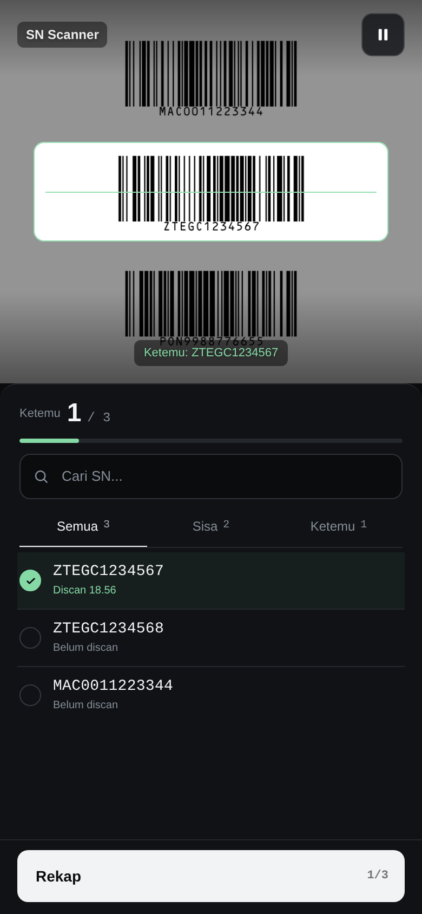

# Warehouse SN Scanner

Aplikasi web **mobile-first** untuk mencocokkan barcode perangkat (modem, ONT, router) dengan daftar Serial Number. Pure client-side — tanpa backend, tanpa database, tanpa request ke server. Seluruh progres disimpan di `localStorage` perangkat.



## Fitur

- **Impor daftar SN** dari tempel teks atau file `.txt` / `.csv` (deteksi kolom `SN` / `Serial Number`, buang duplikat otomatis).
- **Scanner kamera belakang** dengan area scan tipis horizontal **85% × 28%** di tengah viewfinder. Kamera hanya membaca area kotak, jadi barcode MAC/PON di sebelah SN tidak ikut terbaca.
- **Decode di Web Worker** — ZXing tidak memblokir main thread, jadi preview kamera dan checklist tetap mulus di HP kelas menengah. Resolusi crop adaptif mengikuti kemampuan perangkat.
- Format barcode: `CODE_128`, `CODE_39`, `EAN_13`, `QR_CODE`, `DATA_MATRIX`.
- **Feedback tanpa pop-up**: frame hijau + beep + getar untuk match, kuning + beep ganda untuk duplikat, teks kecil untuk bukan target.
- **Checklist live** dengan progress bar, pencarian, filter `Semua` / `Sisa` / `Ketemu`, dan tap manual untuk koreksi.
- **Rekap & ekspor**: salin sisa SN atau laporan lengkap siap tempel ke WhatsApp, lalu reset sesi dengan konfirmasi.
- **Senter** (jika perangkat mendukung), **pause/resume**, **wake lock**, dan penanganan error kamera yang ramah.
- Dark mode kontras tinggi, target sentuh 44px+, aman untuk safe-area iOS/Android.
- Aset scanner (ZXing) disimpan lokal — tidak bergantung CDN saat dipakai.

## Struktur file

```text
warehouse-sn-scanner/
├── index.html                 # markup 2 layar: import & scan
├── manifest.json              # PWA manifest (add to home screen)
├── assets/
│   ├── styles.css             # seluruh desain dark mode
│   ├── app.js                 # state, render, rekap, ekspor, audio
│   ├── scan-core.js           # parsing SN, ROI mapping, decoder ZXing
│   ├── scanner.js             # kamera + crop area scan + decode loop
│   ├── scan-worker.js         # decode ZXing di Web Worker
│   ├── audio.js               # beep Web Audio API (tanpa file audio)
│   ├── zxing.min.js           # @zxing/library 0.21.3 (vendored)
│   ├── icon.svg
│   ├── icon-192.png
│   └── icon-512.png
├── tests/                     # opsional, tidak dipakai saat produksi
├── docs/preview.png           # screenshot untuk README
└── README.md
```

## Jalankan lokal

Kamera browser membutuhkan **secure context**. `localhost` dianggap aman.

```bash
cd warehouse-sn-scanner
python3 -m http.server 8080
```

Buka **http://localhost:8080** di Chrome/Safari. Jangan buka `index.html` lewat `file://` — ES module dan kamera akan diblokir browser.

Alternatif:

```bash
npx serve .
# atau
php -S localhost:8080
```

## Deploy gratis ke HTTPS

### GitHub Pages

1. Buat repo baru, upload isi folder ini (cukup `index.html`, `manifest.json`, `assets/`).
2. Repo → **Settings → Pages**.
3. Source: **Deploy from a branch**, branch `main`, folder `/ (root)`.
4. Buka `https://<username>.github.io/<repo>/`. Build pertama sekitar 1 menit.

### Cloudflare Pages / Vercel

- Framework preset: **None**
- Build command: **kosong**
- Output directory: **`.`** (root)
- Upload/drag folder ini.

HTTPS wajib untuk kamera. `http://` biasa hanya menampilkan pesan bahwa kamera butuh HTTPS.

## Cara pakai

1. Tempel daftar SN (satu per baris, atau pisahkan koma/spasi), atau impor `.txt`/`.csv`.
2. Tekan **Mulai scan** dan izinkan akses kamera.
3. Arahkan **hanya barcode SN** ke kotak tipis. Aplikasi hanya memotong area di dalam kotak setiap ±120 ms.
4. Cocok → baris tercentang hijau + beep + getar. Duplikat → kuning. Bukan target → teks kecil, tanpa alarm.
5. Stiker rusak? Ketuk baris SN untuk centang manual.
6. **Rekap** kapan saja → salin laporan / sisa SN, atau reset sesi.

### Format laporan WhatsApp

```text
*LAPORAN SCAN GUDANG*
Tanggal: 24 Nov 2026, 14.30
Sesi dimulai: 24 Nov 2026, 14.02
Total: 20 SN
Ketemu: 18 SN
Sisa: 2 SN

*BELUM KETEMU (2)*
- ZTEGC1234567
- ZTEGC1234568

*SUDAH KETEMU (18)*
- ...
```

## Optimasi kamera

Kalau HP terasa ngelag saat preview:

1. **Decode dipindah ke Web Worker.** Main thread hanya mengambil crop; ZXing berjalan di worker. Hanya satu frame yang diproses pada satu waktu, jadi frame kamera berikutnya tidak menumpuk.
2. **Kamera 1280×720, target 24–30 fps** (bukan 1080p). Preview lebih ringan, detail barcode tetap cukup untuk strip 85% × 28%.
3. **Resolusi crop adaptif**: 900px untuk perangkat 8 core, 760px untuk 6 core, 640px untuk 4 core / RAM kecil. Kalau decode di worker tetap >120 ms tiga kali berturut-turut, resolusi diturunkan otomatis sampai 480px.
4. **Tanpa `TRY_HARDER`** — mode ZXing yang paling mahal. Barcode di strip sudah dekat dan jelas.
5. **Efek UI diringankan**: frame scan memakai satu garis tipis statis (tanpa glow/animasi), tidak ada `backdrop-filter` di atas video, dan shadow tebal dihapus.
6. **Geometry scan di-cache** dan dihitung ulang saat resize/orientasi, bukan dibaca dari DOM setiap frame.

Kalau masih terasa berat: buka di Chrome (bukan browser dalam Telegram/Instagram), tutup aplikasi kamera lain, dan pastikan HP tidak dalam mode hemat daya ekstrem.

## Catatan penting

- **Data per browser/origin.** Ganti browser, HP, atau alamat deploy = sesi berbeda. Reset lewat menu Rekap.
- **Kamera**: Chrome Android dan Safari iOS 15.4+. Browser dalam aplikasi (Telegram/Instagram) kadang memblokir kamera — buka di Chrome/Safari.
- **Senter** hanya muncul jika browser + kamera mendukung Torch API. iOS Safari umumnya belum mendukung.
- **Getar** tidak tersedia di iOS Safari; feedback suara + visual tetap jalan.
- **Audio** baru aktif setelah user menekan tombol (aturan autoplay). Itu sebabnya `AudioContext` di-unlock di tombol Mulai scan.
- **Tanpa service worker**: halaman perlu dimuat sekali dengan internet. Setelah itu aset biasanya di-cache browser, tetapi bukan jaminan offline penuh.
- **Daftar besar**: render daftar memakai DOM biasa. Untuk ratusan SN masih nyaman; untuk ribuan, pertimbangkan memecah sesi.

## Kustomisasi

- **Warna**: CSS variables di `assets/styles.css` (`--accent`, `--surface`, `--danger`, dll).
- **Area scan**: ubah `.scan-frame` (`left`, `top`, `width`, `height`). `scanner.js` membaca rect yang sama, jadi tidak ada angka duplikat di JS.
- **Format barcode**: daftar format di `assets/scan-worker.js`; fallback `createDecoder()` di `assets/scan-core.js`.
- **Cooldown scan**: `SCAN_COOLDOWN_MS` di `assets/app.js` (default 1500 ms).
- **Interval decode**: `DECODE_INTERVAL_MS` di `assets/scanner.js` (default 120 ms).

## Testing

Tes tersedia di `tests/`. Ringkasnya:

```bash
cd tests
npm install
npm test                 # parser, ROI mapping, decode gambar
```

Tes end-to-end memakai kamera palsu Chromium + video barcode. Jalankan server dari root repo di port 4173 terlebih dahulu:

```bash
python3 -m http.server 4173
```

Lalu di terminal lain:

```bash
./make-video.sh          # butuh ffmpeg
CHROME_PATH=/path/to/chrome npm run test:e2e
```

Detail lengkap di [`tests/README.md`](tests/README.md).

## Pihak ketiga

- **ZXing** (`@zxing/library` 0.21.3) — Apache License 2.0. File: `assets/zxing.min.js`. Teks lisensi: `assets/zxing-LICENSE.txt`.
- Ikon dan desain dibuat untuk proyek ini.
